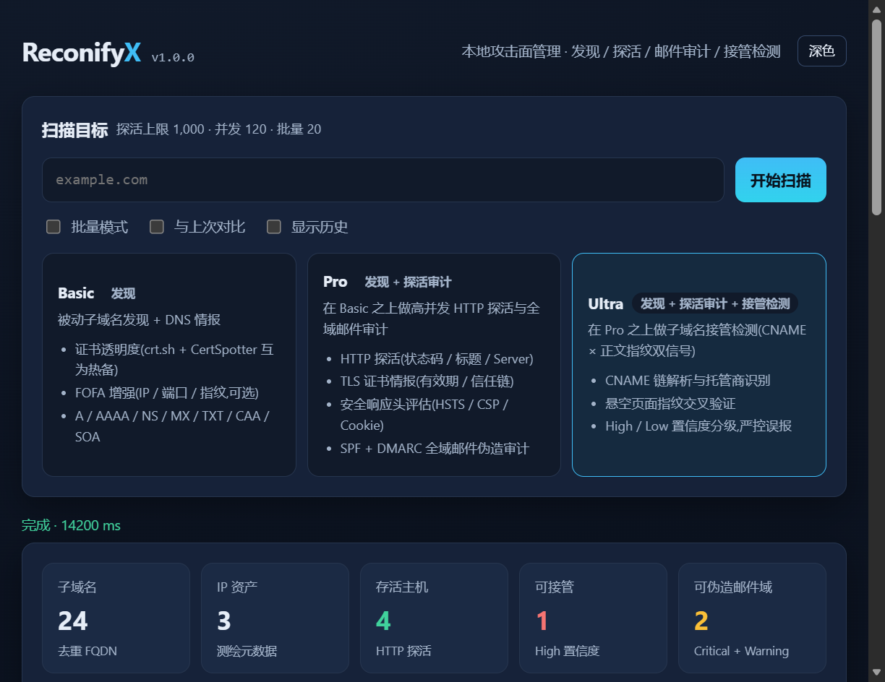
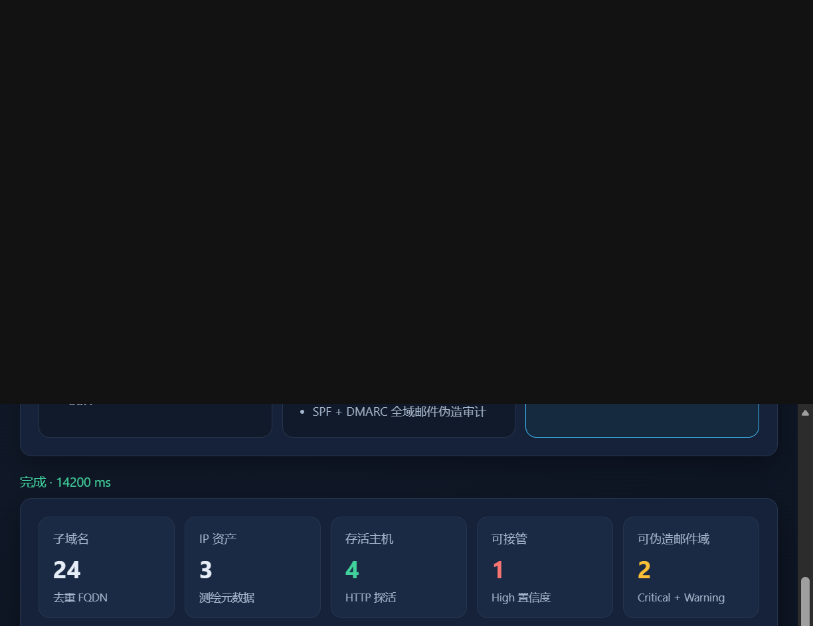

# ReconifyX

**English** | [简体中文](README.md)

**Local, self-hosted attack surface management (ASM).** Give it one domain and a single
scan returns subdomains, live assets, TLS certificate and security-header intel, SPF/DMARC
spoofing risk, subdomain-takeover risk, a weighted risk score, and a diff against the
previous scan of the same domain.

```bash
pip install -r requirements.txt
python -m reconifyx scan example.com -p ultra --md report.md
```



<p align="center">
  
  
  
  
  
</p>

> Initiated by [Cat-liko](https://github.com/Cat-liko), built in collaboration with
> **Claude Code** and **DeepSeek**. Contributors and the GitHub avatar-list rules are
> documented in [`CONTRIBUTORS.md`](CONTRIBUTORS.md).

---

## ⚠️ Authorized testing only

This tool may only be used against targets **you own or have explicit written
authorization to test**. Scanning, probing and any verification request against an
unauthorized target can be illegal (in China: the Cybersecurity Law, the Data Security
Law and Article 285 of the Criminal Law; other jurisdictions have equivalent provisions).
Responsibility rests entirely with the user.

The program listens on `127.0.0.1` only by default. If you expose it to other people,
set `API_KEY` first — otherwise anyone who can reach the port can use it to probe
arbitrary domains.

---

## The problem it solves

Once an asset-mapping pass is done, the hard questions are these four:

1. **Which assets are actually alive now?** Certificate Transparency logs only say
   "existed once".
2. **Which configuration is creating risk?** Expired certificates, missing HSTS/CSP,
   spoofable sending domains, CNAMEs pointing at third parties that have gone dangling.
3. **Which one do I look at first?** 200 subdomains plus dozens of findings — what a human
   needs is a ranking, not a list.
4. **What changed since last week?** Almost all of ASM's value lives in the diff.

ReconifyX answers these with three progressively deeper pipelines, and writes "this data
may be incomplete" (an upstream source is down, results were truncated) honestly into the
result instead of pretending the scan finished.

## The three plans

| Plan | What it does | Additional output |
|---|---|---|
| **Basic** | Passive subdomain discovery (Certificate Transparency + optional FOFA) + DNS intel | Subdomains, IP assets, A/AAAA/NS/MX/TXT/CAA/SOA |
| **Pro** | Basic + high-concurrency HTTP liveness probing + TLS certificates + security headers + domain-wide SPF/DMARC audit | Live assets, certificate validity/trust chain, missing security headers, spoofable mail domains |
| **Ultra** | Pro + subdomain takeover detection (CNAME × dangling-page fingerprint, two signals) | High/Low confidence takeover verdicts |

Every plan additionally produces a **risk ledger** (0–100 weighted score + A–F grade +
findings aggregated by severity), and Pro/Ultra results can be **diffed** against the
previous scan of the same domain.

## Not just a web page

```bash
# 1) CLI: run one pipeline directly, no server needed
reconifyx scan example.com                 # Basic, fastest
reconifyx scan example.com -p ultra        # the full stack
reconifyx scan example.com --json out.json --csv out.csv --md report.md -q

# 2) DNS only (no subdomain discovery, a few hundred milliseconds)
reconifyx dns example.com

# 3) WebUI + HTTP API
reconifyx serve --port 8000
```

The CLI and the API share the same pipeline function, so caching, concurrency caps and
degradation semantics are identical — a domain the CLI just scanned is served from cache
when the API is asked for it next.

`--json -` writes the result to stdout so it can be piped straight into `jq` or CI. When
the scan degrades (every backbone source failed) the CLI exits non-zero by default
(`--allow-degraded` opts out), so CI can tell the data is untrustworthy.

## Install

Four ways, pick the one that fits:

```bash
# A. From source (recommended for development)
git clone https://github.com/Cat-liko/ReconifyX-V2.git && cd ReconifyX-V2
python -m pip install -r requirements.txt
python -m reconifyx serve

# B. Install as a package (provides the `reconifyx` command)
python -m pip install .

# C. Docker
docker build -t reconifyx:local .
docker run --rm -p 8000:8000 -v "$PWD/res:/data" reconifyx:local
# or: docker compose up

# D. Windows single-file exe (no Python required)
#    Download: https://github.com/Cat-liko/ReconifyX-V2/releases
build_exe.bat          # build it yourself: produces dist\ReconifyX.exe
```

On Windows you can also just double-click `start.bat` (installs dependencies on first run).

Requires **Python 3.10+**. There are only five runtime dependencies: `fastapi`, `uvicorn`,
`pydantic-settings`, `httpx` and `dnspython`. TLS inspection, metrics, history and export
are all implemented with the standard library.

## Usage

### WebUI

Open `http://127.0.0.1:8000`. Pick a plan → enter a domain → results are grouped into tabs
(Overview / Subdomains / Live assets / DNS / Mail audit / Takeover / Certificates & headers
/ Sources / Diff / Raw JSON). Every table has a filter box, and JSON / CSV / Markdown can
be exported from the top-right corner.

Batch mode is supported (one domain per line, capped by `BATCH_MAX_DOMAINS`), as is a
light/dark theme toggle.



### HTTP API

| Method | Path | Description |
|---|---|---|
| `POST` | `/scan` | Submit a scan `{"domain":"example.com","plan":"Ultra"}` → returns a `job_id` immediately |
| `POST` | `/scan/batch` | Submit a batch `{"domains":[...],"plan":"Basic"}` (≤ `BATCH_MAX_DOMAINS`) |
| `GET` | `/scan/{job_id}` | Poll status (queued/running/completed/failed) and the result |
| `GET` | `/scan/{job_id}/export?format=json\|csv\|md` | Export (with `Content-Disposition`) |
| `GET` | `/scan/{job_id}/diff` | Diff against the previous scan of the same domain |
| `GET` | `/history?domain=` | Scan history (risk score over time) |
| `GET` | `/dns?domain=` | DNS intel only |
| `GET` | `/debug/scan?domain=&plan=` | Synchronous scan (blocks until done), for debugging |
| `GET` | `/api/meta` | Capabilities, limits, whether auth is enabled |
| `GET` | `/healthz` `/readyz` `/metrics` | Liveness / readiness / Prometheus metrics |

Errors always come back as `{"status":"error","message":"..."}`: invalid domain `422`,
unknown plan `400`, expired job `404`, export before completion `409`.

```bash
curl -s -X POST localhost:8000/scan -H 'Content-Type: application/json' \
     -d '{"domain":"example.com","plan":"Ultra"}'
curl -s localhost:8000/scan/<job_id> | jq '.result.risk'
```

### As a Python library

```python
import asyncio
from app.main import scan_domain

domain, plan, data, degraded, sources = asyncio.run(scan_domain("example.com", "Pro"))
print(data.total_found, data.total_live, data.risk.risk_score)
```

## Configuration

Everything is configured through environment variables or `.env` (copy `.env.example`).
The common ones:

| Variable | Default | Description |
|---|---|---|
| `HOST` / `PORT` | `127.0.0.1` / `8000` | Bind address. Set `API_KEY` before moving off loopback |
| `API_KEY` | empty | When non-empty, every scan endpoint requires the `X-API-Key` header |
| `RATE_LIMIT_PER_MINUTE` / `RATE_LIMIT_BURST` | `240` / `60` | Per-IP token bucket (misuse guard, not a security boundary) |
| `CERTSPOTTER_TOKEN` | empty | Optional, raises the CertSpotter quota. **Leaving it empty is fine**; a fake value returns 401 and degrades the whole scan |
| `FOFA_PASSWORD` | empty | Optional. When empty the FOFA source is disabled and `assets` degrades to empty |
| `CACHE_TTL_SECONDS` / `CACHE_STALE_MAX_SECONDS` | `12h` / `7d` | The fresh / stale windows |
| `PROBE_CONCURRENCY_CAP` | `120` | Liveness-probe concurrency cap (effectively `min(targets, cap)`) |
| `PRO_MAX_PROBE_TARGETS` / `PRO_MAX_AUDIT_TARGETS` / `ULTRA_MAX_TAKEOVER_TARGETS` | `1000` | Per-stage target caps; exceeding them is reported as `*_complete=false` |
| `PROBE_READ_MAX_BYTES` | `64 KiB` | Max response body read per target (the connection is dropped once reached) |
| `PROBE_TLS_ENABLED` / `PROBE_TLS_MAX_TARGETS` | `true` / `200` | Certificate intel switch and cost cap |
| `HISTORY_ENABLED` / `HISTORY_DB_PATH` | `true` / `data/reconifyx.db` | Scan history (SQLite), used for diffs |
| `RESULT_DIR` | `res` | Directory for result JSON files |

The full list is in [`app/core/config.py`](app/core/config.py) — every entry carries a
comment explaining why it exists (in Chinese).

## Design notes

To judge quickly whether this project is written seriously, these are the places to look
(see [`docs/DESIGN.md`](docs/DESIGN.md) for details):

- **Latency**: the three Pro/Ultra branches (HTTP probing / DNS mail audit / DNS CNAME
  fan-out) run concurrently with `asyncio.gather`, so wall time is the **max**, not the
  sum. DNS intel and subdomain discovery in the discovery stage are concurrent too.
- **Upstream flapping**: a `stale-while-revalidate` cache (12h fresh / 7d servable) plus
  **single-flight** request coalescing. Degraded snapshots are cached with `fresh_ttl=0`:
  they can be served immediately but are always STALE, so the next request retries.
- **Honest degradation**: `degraded` (all backbone sources failed), `probe_complete` /
  `audit_complete` / `takeover_complete` (whether a stage was truncated) are public fields,
  not a line buried in a log.
- **Pinned cost**: at most 64 KiB is read per probe (streamed, aborted once full);
  certificate collection has a target cap; every fan-out has a concurrency cap that
  converges on the real target count.
- **Strict verdicts**: a takeover is only `High` when the CNAME points at the host **and**
  the body matches that provider's dangling fingerprint. Single-signal cases land in `Low`
  for human review and do not count toward `vulnerable_count`. A bare `all` in SPF is
  treated as `+all` per RFC 7208 and judged Critical.
- **Trusted input boundary**: domains pass through `normalize_domain` (they end up in cache
  keys and file names); before writing to disk there is a second round of character
  sanitizing and a directory-containment check; `extra="forbid"` makes the Union
  validation fail loudly instead of silently dropping fields.
- **No HTML concatenation**: the frontend uses `createElement` + `textContent` throughout.
  Executing a target page's title inside a security tool's UI would be this project's most
  ironic vulnerability.

## Development

```bash
python -m pip install -r requirements-dev.txt

python -m pytest -q                  # 284 tests, fully offline
python -m ruff check .               # ruleset in ruff.toml (deliberately narrow: E/W/F/I)
python -m pyflakes app launcher.py reconifyx tests
python -m compileall -q app reconifyx tests launcher.py
```

The tests **never touch the network**: the API is driven through `httpx.ASGITransport`,
HTTP probing runs against a local `asyncio.start_server`, and DNS is stubbed. So CI needs
no network and never goes red because an upstream flapped.

```bash
make test        # see Makefile: install / test / lint / run / build-exe / docker-*
```

Layout:

```
app/
  core/      config domain cache jobs history singleflight metrics guards publicsuffix
  schemas/   every public pydantic model
  services/  basic dns probe tls headers audit takeover risk diff export
  static/    index.html app.js style.css favicon.svg
  main.py    FastAPI app + the three pipelines
reconifyx/   CLI entry point (scan / dns / serve / version)
launcher.py  single entry point: double-click = serve, with args = CLI
tests/       offline tests
docs/        design notes and screenshots
```

## Packaging

```bash
python -m pip install pyinstaller
python -m PyInstaller --noconfirm --clean ReconifyX.spec
# → dist/ReconifyX.exe
```

The artifact is a single file that binds loopback only, picks a free port and opens the
browser. On first run a Windows Defender prompt depends on local reputation settings;
sign with an organization certificate before distributing widely.

## Known limitations

Listing them honestly beats pretending they don't exist:

1. **The FOFA source depends on an unofficial relay** whose stability and compliance are
   outside this project's control, so it is treated as an *enhancement* source: if it
   fails, backbone verdicts are unaffected and only `assets` comes back empty.
2. **Azure blind spot in takeover detection**: a dangling Azure record signals as
   NXDOMAIN on the CNAME target, while this tool uses a body fingerprint as its second
   signal, so the NXDOMAIN variant is not covered.
3. **Single-process in-memory state**: the cache and job store live in the process, so a
   multi-worker deployment needs a different backend (`cache.py` / `jobs.py` already have
   the abstraction layer and comments). The history store is SQLite: multi-process reads,
   still a single-machine file.
4. **Jobs are kept for 10 minutes**: after that `GET /scan/{id}` returns 404; the result
   JSON is already on disk under `res/`.
5. **No port scanning, no brute force, no exploit packets.** This is passive mapping plus
   security-configuration auditing, not a vulnerability scanner.

## Contributing

See [`CONTRIBUTING.md`](CONTRIBUTING.md) (in Chinese). For security issues use the private
channel described in [`SECURITY.md`](SECURITY.md) — please don't open a public issue.

## Credits

This project is a product of human–AI collaboration, credited honestly:

| Contributor | Contribution |
|---|---|
| Claude Code | 0.1.0 prototype: the original implementation and approach |
| [DeepSeek](https://www.deepseek.com/) | 1.0.0 rewrite: pipeline hardening, offline test coverage, packaging and release prep |
| [xiaoqilin711](https://github.com/xiaoqilin711) | Project participation |

Maintainer: [Cat-liko](https://github.com/Cat-liko). See [`CONTRIBUTORS.md`](CONTRIBUTORS.md)
for the full record and how to add yourself.

## License

[AGPL-3.0](LICENSE). If you run a modified version as a network service for others, you
must publish your changes too.
