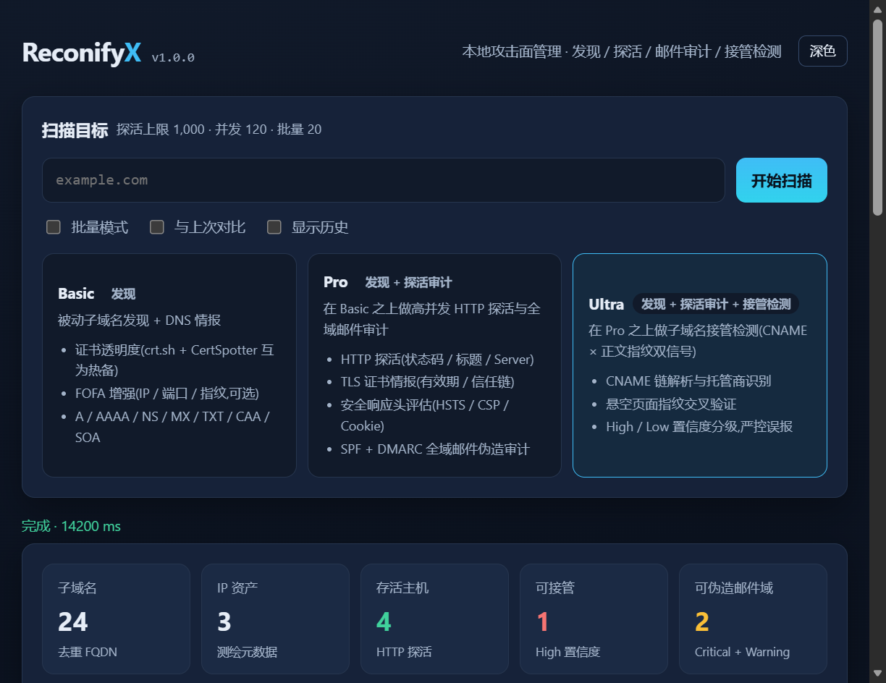
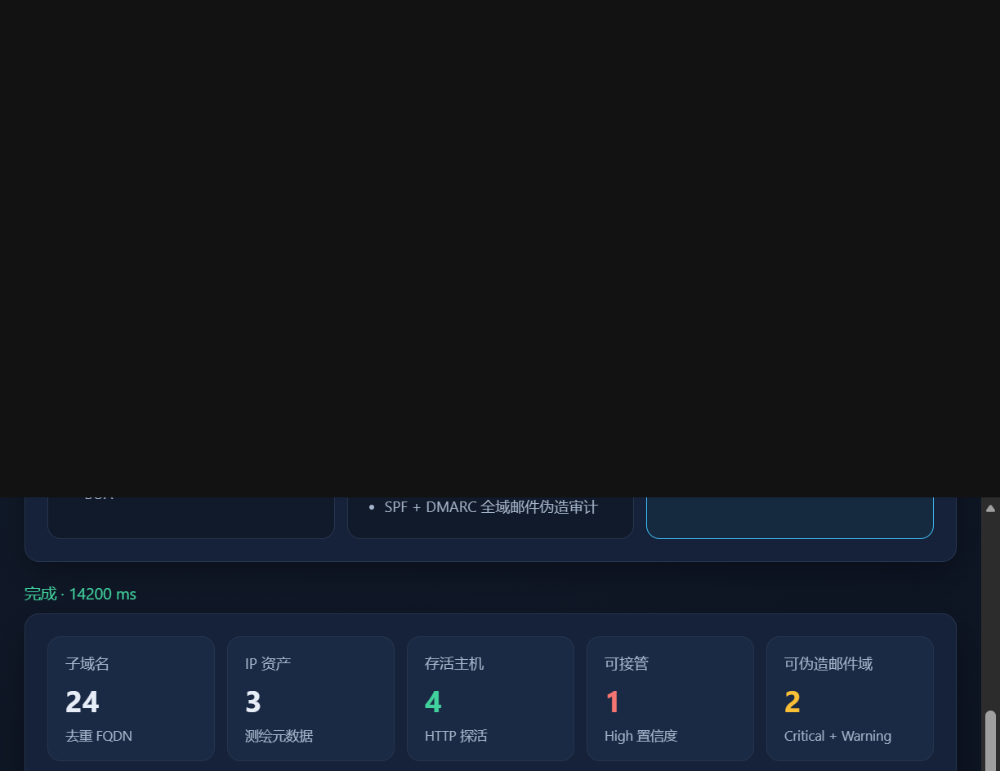

# ReconifyX

**本地自部署的攻击面管理（ASM）工具**：输入一个域名，一次扫描给出子域名、存活资产、TLS 证书与安全响应头、SPF/DMARC 邮件伪造风险、子域名接管风险、风险总账，以及与上一次扫描的差异。

> **Local, self-hosted attack surface management.** One domain in, one report out:
> subdomains, live assets, TLS & security-header intel, SPF/DMARC spoofing risk,
> subdomain takeover, a weighted risk score, and a diff against the previous scan.

```bash
pip install -r requirements.txt
python -m reconifyx scan example.com -p ultra --md report.md
```



<p align="center">
  
  
  
  
  
</p>

---

## ⚠️ 仅限授权测试

本工具只能用于**你拥有所有权、或已获得明确书面授权**的目标。扫描、探测、以及任何
验证性请求在未授权目标上都可能违法（中国：《网络安全法》《数据安全法》《刑法》第 285 条；
其他司法辖区同样有对应条款）。责任完全由使用者承担。

程序默认只监听 `127.0.0.1`。如果你要把它暴露给其他人用，请先设置 `API_KEY`，
否则任何能访问该端口的人都能拿它去探测任意域名。

---

## 它解决什么问题

做完一次资产测绘之后，真正难的是四个问题：

1. **哪些资产现在真的活着？** —— 证书透明度日志只说明"曾经存在过"。
2. **哪些配置正在制造风险？** —— 过期证书、缺失的 HSTS/CSP、可被伪造的发信域、
   指向第三方却已悬空的 CNAME。
3. **先看哪一个？** —— 200 个子域 + 几十条 finding，人要的是排序，不是清单。
4. **和上周比变了什么？** —— ASM 的价值几乎全在"变化"上。

ReconifyX 用三条逐层加深的管线回答这四个问题，并把"数据可能不完整"（上游挂了、
被截断了）如实写在结果里，而不是假装扫完了。

## 三个计划

| 计划 | 做什么 | 增量产出 |
|---|---|---|
| **Basic** | 被动子域名发现（证书透明度 + 可选 FOFA）+ DNS 情报 | 子域名、IP 资产、A/AAAA/NS/MX/TXT/CAA/SOA |
| **Pro** | Basic + 高并发 HTTP 探活 + TLS 证书 + 安全响应头 + 全域 SPF/DMARC 审计 | 存活资产、证书有效期/信任链、缺失的安全头、可伪造的邮件域 |
| **Ultra** | Pro + 子域名接管检测（CNAME × 悬空页面指纹双信号） | High/Low 置信度的接管结论 |

所有计划都会额外产出**风险总账**（0-100 加权分 + A-F 等级 + 按严重度排序的聚合项），
Ultra 与 Pro 的结果还能和该域名的上一次扫描做**差异对比**。

## 不只是网页

```bash
# 1) 命令行:直接跑一条管线,不需要起服务
reconifyx scan example.com                 # Basic,最快
reconifyx scan example.com -p ultra        # 全家桶
reconifyx scan example.com --json out.json --csv out.csv --md report.md -q

# 2) 只看 DNS(不跑子域名发现,几百毫秒)
reconifyx dns example.com

# 3) WebUI + HTTP API
reconifyx serve --port 8000
```

CLI 与 API 共享同一条管线函数,所以缓存、并发上限、降级语义完全一致 —— CLI 刚扫过的
域名,接着用 API 查会直接命中缓存。

`--json -` 可以把结果写到 stdout,直接接进 `jq` / CI 管道。退化为"骨干源全挂"时
CLI 默认返回非零退出码（`--allow-degraded` 可放行），方便 CI 感知数据不可信。

## 安装

四种方式，按场景选：

```bash
# A. 源码运行（推荐开发）
git clone <this repo> && cd ReconifyX
python -m pip install -r requirements.txt
python -m reconifyx serve

# B. 作为包安装（得到 reconifyx 命令）
python -m pip install .

# C. Docker
docker build -t reconifyx:local .
docker run --rm -p 8000:8000 -v "$PWD/res:/data" reconifyx:local
# 或：docker compose up

# D. Windows 单文件 exe
build_exe.bat          # 产物：dist\ReconifyX.exe
```

Windows 用户也可以直接双击 `start.bat`（首次运行会自动装依赖）。

要求 **Python 3.10+**。运行时依赖只有 5 个：`fastapi` / `uvicorn` / `pydantic-settings`
/ `httpx` / `dnspython`。TLS、指标、历史、导出全部用标准库实现。

## 使用

### WebUI

浏览器打开 `http://127.0.0.1:8000`。选计划 → 输入域名 → 结果按标签页分组
（概览 / 子域名 / 存活资产 / DNS / 邮件审计 / 接管 / 证书与响应头 / 数据源 / 对比 / 原始 JSON），
每个表格都带过滤框，右上角可以导出 JSON / CSV / Markdown。

支持批量模式（每行一个域名，上限由 `BATCH_MAX_DOMAINS` 控制），以及明暗主题切换。



### HTTP API

| 方法 | 路径 | 说明 |
|---|---|---|
| `POST` | `/scan` | 提交扫描 `{"domain":"example.com","plan":"Ultra"}` → 立即返回 `job_id` |
| `POST` | `/scan/batch` | 批量提交 `{"domains":[...],"plan":"Basic"}`（≤ `BATCH_MAX_DOMAINS`） |
| `GET` | `/scan/{job_id}` | 轮询状态（queued/running/completed/failed）与结果 |
| `GET` | `/scan/{job_id}/export?format=json\|csv\|md` | 导出（带 `Content-Disposition`） |
| `GET` | `/scan/{job_id}/diff` | 与同域名上一次扫描的差异 |
| `GET` | `/history?domain=` | 历史扫描列表（风险分随时间变化） |
| `GET` | `/dns?domain=` | 只查 DNS 情报 |
| `GET` | `/debug/scan?domain=&plan=` | 同步扫描（阻塞至完成），调试用 |
| `GET` | `/api/meta` | 能力、限额、是否启用鉴权 |
| `GET` | `/healthz` `/readyz` `/metrics` | 存活 / 就绪 / Prometheus 指标 |

错误一律返回 `{"status":"error","message":"..."}`，非法域名 `422`，未知计划 `400`，
job 过期 `404`，未完成就导出 `409`。

```bash
curl -s -X POST localhost:8000/scan -H 'Content-Type: application/json' \
     -d '{"domain":"example.com","plan":"Ultra"}'
curl -s localhost:8000/scan/<job_id> | jq '.result.risk'
```

### Python 库

```python
import asyncio
from app.main import scan_domain

domain, plan, data, degraded, sources = asyncio.run(scan_domain("example.com", "Pro"))
print(data.total_found, data.total_live, data.risk.risk_score)
```

## 配置

全部走环境变量或 `.env`（复制 `.env.example`）。常用项：

| 变量 | 默认 | 说明 |
|---|---|---|
| `HOST` / `PORT` | `127.0.0.1` / `8000` | 监听地址。改非回环前请先设 `API_KEY` |
| `API_KEY` | 空 | 非空则所有扫描类端点要求 `X-API-Key` 头 |
| `RATE_LIMIT_PER_MINUTE` / `RATE_LIMIT_BURST` | `240` / `60` | 每 IP 令牌桶（防误用，不是安全边界） |
| `CERTSPOTTER_TOKEN` | 空 | 可选，提升 CertSpotter 限额。**留空即可**；填假值会 401 并让整次扫描降级 |
| `FOFA_PASSWORD` | 空 | 可选。留空则 FOFA 源禁用，`assets` 退化为空 |
| `CACHE_TTL_SECONDS` / `CACHE_STALE_MAX_SECONDS` | `12h` / `7d` | fresh / stale 两段窗口 |
| `PROBE_CONCURRENCY_CAP` | `120` | 探活并发上限（实际取 `min(目标数, 上限)`） |
| `PRO_MAX_PROBE_TARGETS` / `PRO_MAX_AUDIT_TARGETS` / `ULTRA_MAX_TAKEOVER_TARGETS` | `1000` | 单次扫描各阶段的目标上限，超出会显式标 `*_complete=false` |
| `PROBE_READ_MAX_BYTES` | `64 KiB` | 单目标最多读取的响应体（超出立即断开） |
| `PROBE_TLS_ENABLED` / `PROBE_TLS_MAX_TARGETS` | `true` / `200` | 证书情报开关与成本上限 |
| `HISTORY_ENABLED` / `HISTORY_DB_PATH` | `true` / `data/reconifyx.db` | 扫描历史（SQLite），用于 diff |
| `RESULT_DIR` | `res` | 结果 JSON 落盘目录 |

完整清单见 [`app/core/config.py`](app/core/config.py) —— 每一项都带中文注释说明为什么存在。

## 设计要点

想快速判断这个项目是不是"认真写的"，看这几处就够（详见 [`docs/DESIGN.md`](docs/DESIGN.md)）：

- **延迟**：Pro/Ultra 的三条支线（HTTP 探活 / DNS 邮件审计 / DNS CNAME 扇出）用
  `asyncio.gather` 并发，墙钟取 **max** 而不是求和；发现层的 DNS 情报与子域名发现同样并发。
- **上游抖动**：`stale-while-revalidate` 缓存（12h 新鲜 / 7d 可服务）+ **single-flight**
  合并同键并发请求。降级快照以 `fresh_ttl=0` 入缓存 —— 立刻能返回，但永远判 STALE，
  下次请求就会重试。
- **诚实降级**：`degraded`（骨干源全挂）、`probe_complete` / `audit_complete` /
  `takeover_complete`（是否被上限截断）都是对外字段，而不是日志里的一句话。
- **成本钉死**：单目标探活最多读 64 KiB（流式读取，读满即断）；证书采集有目标数上限；
  所有扇出并发都有 cap 且按实际目标数收敛。
- **判定从严**：接管只有"CNAME 指向托管商 **且** 正文命中该商悬空指纹"才判 High；
  单信号的进 Low 供人工复核，不计入 `vulnerable_count`。裸 `all` 按 RFC 7208 等价
  `+all` 判 Critical。
- **可信输入边界**：域名先过 `normalize_domain`（它会进缓存键与文件名）；落盘前再做一次
  字符消毒 + 目录包含性校验；`extra="forbid"` 让 Union 校验报错而不是静默丢字段。
- **不拼 HTML**：前端全程 `createElement` + `textContent`。把目标页面标题塞进安全工具的
  界面上执行脚本，会是本项目最讽刺的一个漏洞。

## 开发

```bash
python -m pip install -r requirements-dev.txt

python -m pytest -q                  # 284 个测试，全部离线
python -m ruff check .               # 规则集见 ruff.toml（刻意选窄：E/W/F/I）
python -m pyflakes app launcher.py reconifyx tests
python -m compileall -q app reconifyx tests launcher.py
```

测试**不访问外网**：API 用 `httpx.ASGITransport`，HTTP 探活用本地
`asyncio.start_server`，DNS 用桩。所以 CI 里不需要网络，也不会因为上游抖动而红。

```bash
make test        # 见 Makefile：install / test / lint / run / build-exe / docker-*
```

目录结构：

```
app/
  core/      config domain cache jobs history singleflight metrics guards publicsuffix
  schemas/   全部对外 pydantic 模型
  services/  basic dns probe tls headers audit takeover risk diff export
  static/    index.html app.js style.css favicon.svg
  main.py    FastAPI 应用 + 三条管线编排
reconifyx/   命令行入口（scan / dns / serve / version）
launcher.py  统一入口：双击=起服务，带参数=CLI
tests/       离线测试
docs/        设计与截图
```

## 打包

```bash
python -m pip install pyinstaller
python -m PyInstaller --noconfirm --clean ReconifyX.spec
# → dist/ReconifyX.exe
```

产物是单文件、只监听回环、自动选端口并打开浏览器。首次运行的 Windows Defender
提示取决于本机信誉设置；对外分发前应使用组织证书签名。

## 已知限制

诚实列出来，比假装没有好：

1. **FOFA 源依赖非官方中转站**，稳定性与合规性不受本项目控制，因此只当"增强源"：
   它挂了不影响骨干判定，只是 `assets` 为空。
2. **接管检测的 Azure 盲区**：Azure 悬空的信号本质是 CNAME 目标 NXDOMAIN，而本工具用
   "正文指纹"作第二信号，覆盖不到 NXDOMAIN 型变体。
3. **单进程内存态**：缓存与 job 存储在进程内，多 worker 部署需要换后端（`cache.py` /
   `jobs.py` 已留好抽象层与注释）。历史库是 SQLite，支持多进程读但仍是单机文件。
4. **job 保留 10 分钟**：过期后 `GET /scan/{id}` 返 404；结果 JSON 已落盘在 `res/`。
5. **不做端口扫描、不做爆破、不发包试探漏洞**。这是被动测绘 + 安全配置审计工具，
   不是漏洞扫描器。

## 贡献

见 [`CONTRIBUTING.md`](CONTRIBUTING.md)。安全问题请走 [`SECURITY.md`](SECURITY.md) 的
私下渠道，不要开公开 issue。

## 许可证

[AGPL-3.0](LICENSE)。如果你把它作为网络服务提供给他人使用，也需要开源你的修改。
